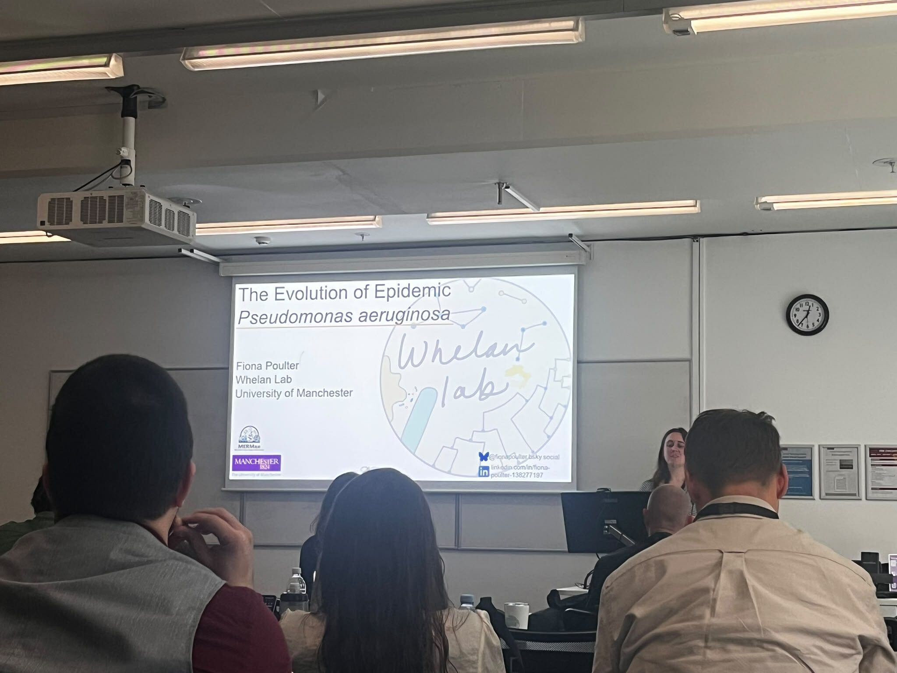

A huge congratulations to Fiona Poulter for her recent presentation award. Fiona presented her talk entitled "The Evolution of Epidemic *Pseudomonas aeruginosa*", at [Genome Science 2026][genomescience] held recently in Manchester, 14-16 September. Fiona's talk covered the research that she has conducted as part of the first year of her PhD studies where she has been looking for genomic and phylogenetic signatures unique to epidemic strains of *P. aeruginosa*. Fiona took away the prize for "Besk Talk", made all the more special given that this was Fiona's first full-length talk at an international conference!!

Congratulations, Fiona!

[genomescience]:https://genomescience.org.uk/

{:refdef: style="text-align: center;"}
{:width="700px" }
{: refdef}

